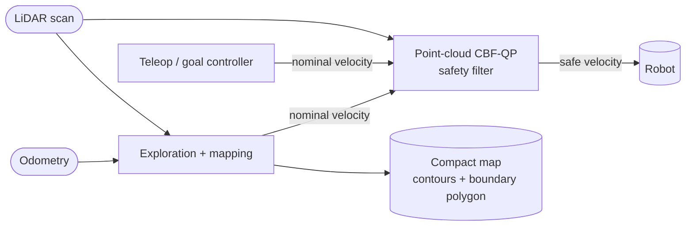
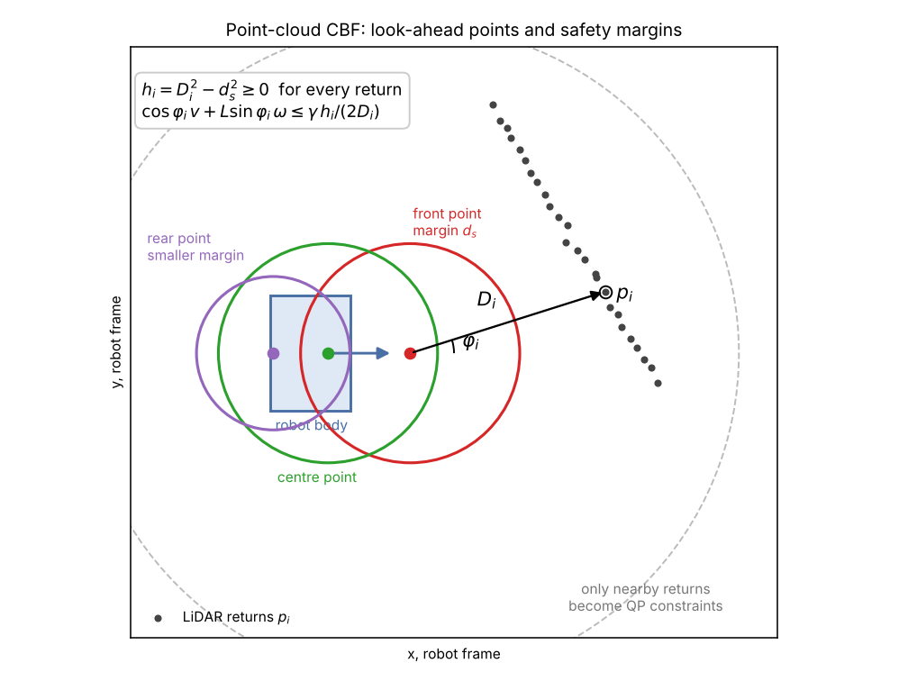

# Safe Exploration and Mapping with Point-Cloud Control Barrier Functions

Public summary of my research on **safety-critical navigation for mobile robots**. The method uses Control Barrier Functions (CBFs) built directly from LiDAR point clouds and solved as a Quadratic Program (QP) inside a ROS 2 control loop. It was developed and tested on the TurtleBot3 Burger, both in Gazebo simulation and on hardware.

> **Paper:** *Storage-efficient safe exploration and mapping using point cloud control barrier functions*. A. Pothula, K. Shenoy, A. D. Mahindrakar. Accepted at the Indian Control Conference (ICC), IIT Kharagpur, January 2027.

The implementation is kept in a private repository. This page explains what the system does and how it is put together.

---

## The idea in one paragraph

A safety filter sits between any velocity source (teleop, a goal controller or an exploration planner) and the robot. **Every LiDAR return becomes its own barrier constraint.** There is no obstacle segmentation, no occupancy grid and no Simultaneous Localisation and Mapping (SLAM) back end. A small QP picks the velocity closest to the requested one that keeps the robot outside a safety margin. On top of this filter, an exploration layer finds obstacles, traces them and rebuilds the room boundary. It stores the result as a compact map of obstacle contours and a simplified boundary polygon, rather than a grid. That compact map is what *storage-efficient* in the title refers to.

---

## How it works



### Safety filter

The robot is modelled as a unicycle with linear velocity $v$ and angular velocity $\omega$. For each LiDAR return $i$, let $D_i$ be its distance from a look-ahead point on the robot body and $d_s$ the safety margin. The barrier is

```math
h_i = D_i^2 - d_s^2 ,
```

and the CBF condition $\dot h_i \ge -\gamma h_i$ (with gain $\gamma > 0$) becomes one **linear** inequality in $(v, \omega)$. Constraints are taken from several look-ahead points along the body (front, centre and rear) so that the whole footprint is protected, not just one point.



In the figure, $\varphi_i$ is the bearing of return $p_i$ seen from a look-ahead point, and $L$ is that point's offset along the robot's heading.

All the inequalities are stacked into a QP:

```math
\min_{v,\,\omega}\ w_v (v - v_{\text{nom}})^2 + w_\omega (\omega - \omega_{\text{nom}})^2
\quad \text{s.t. stacked CBF constraints and actuator limits,}
```

where $(v_{\text{nom}}, \omega_{\text{nom}})$ is the requested command and $w_v$, $w_\omega$ are weights. The weights favour **steering around obstacles over braking**. The output is then rate-limited and lifted out of the motor deadband so that it behaves on real hardware. A deadlock layer (crawl detection, an escape-direction QP and an in-place turn when the QP is infeasible) handles symmetric traps, where a pure minimal-intervention filter would otherwise stall.

### Exploration and mapping

- **Reliable points.** Far LiDAR returns are accumulated in a coarse grid, and only repeatedly observed cells count.
- **Targets.** Density-based clustering splits the points into room walls and free-standing obstacles. The nearest unmapped obstacle becomes the next target.
- **Gap-first frontier.** The robot heads for openings it can physically fit through, scored on direction, width, depth and how often that direction has been visited.
- **Tracing.** The robot wall-follows each obstacle under the safety filter and fits a circle to the traced contour. Once the loop closes, the obstacle is stored as a pillar.
- **Drift correction without SLAM.** When the robot passes an obstacle it has already traced, the offset to the stored contour corrects odometry drift.
- **Boundary.** The room outline is rebuilt from the reliable points (a polar median around the centroid, gap filling and smoothing) and simplified into a polygon.

The run ends on its own once no targets remain and the boundary stops changing. The map is saved as JSON.

---

## Development path

| Stage | What was added |
|---|---|
| Early 2026 | 1D wall barrier on odometry; homing; rectangular-workspace CBF |
| Mar 2026 | LiDAR CBF over a field of view; look-ahead-point CBF solved as a QP; goal controller; logging and plotting tools |
| Mar–Apr 2026 | CBF combined with wall following; obstacle tracing; frontier exploration and mapping |
| Apr–Jul 2026 | Split into separate safety and autonomy nodes; hardware fixes; finite-difference barrier gradients |
| Oct–Nov 2026 (in progress) | Successor pipeline with a polyline boundary and 2D scan-matching pose correction, now running on hardware |

---

## Stack

ROS 2 Humble · Python (NumPy, SciPy) · TurtleBot3 Burger with LDS-01 LiDAR · Gazebo · RViz2

---

## Acknowledgements

Carried out in the Systems and Control Lab, Department of Electrical Engineering, IIT Madras, under the supervision of Prof. Arun D. Mahindrakar.

## Contact

Happy to discuss safe navigation, constraint-based control or ROS safety architectures. Please open an issue or reach out.

**Adithya Pothula**, Project Associate, IIT Madras
GitHub: [adithya2204](https://github.com/adithya2204) · [Google Scholar](https://scholar.google.com/citations?hl=en&user=NI9WpkQAAAAJ)
